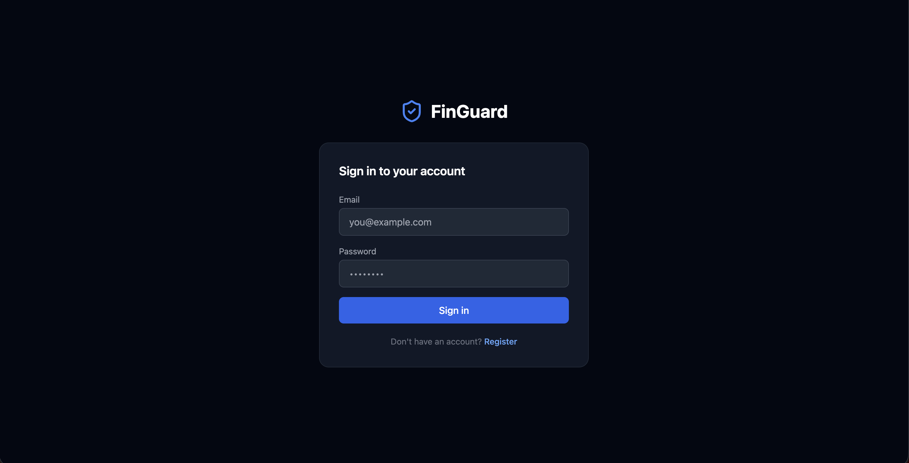
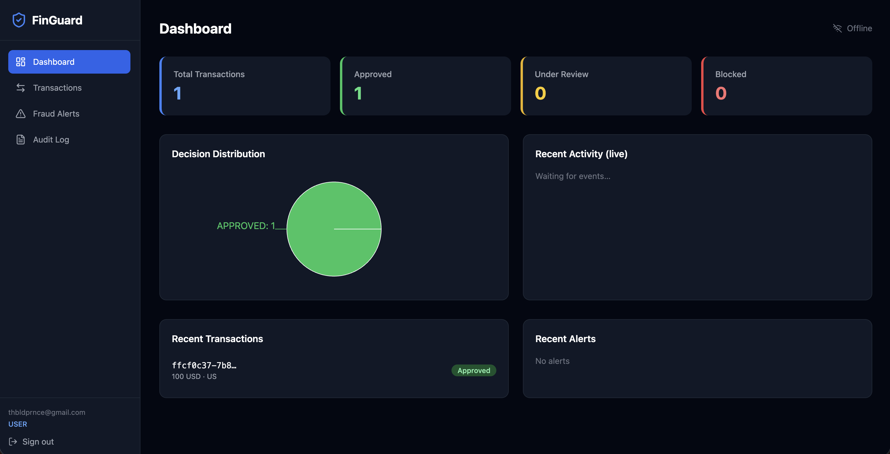
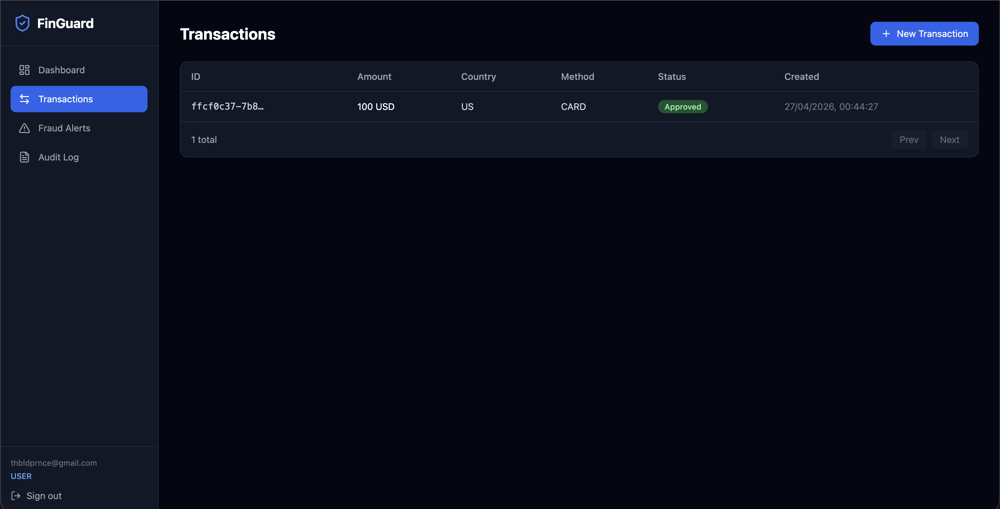

<div align="center">

# FinGuard

### Real-Time Anti-Fraud Transaction Monitoring System

A production-grade, event-driven microservice platform for real-time fraud detection in financial systems.  
Built with Java 21, Spring Boot 3, Apache Kafka, and React.

<br/>


</div>

---

## Overview

Financial fraud costs the global economy hundreds of billions of dollars every year. Every payment made online, every card swipe at a terminal, and every wire transfer carries the risk of being fraudulent. Fintech companies need systems that can analyze transactions **in real time** — within milliseconds of a transaction being created — and flag or block suspicious activity before money leaves an account.

**FinGuard** simulates exactly this problem. When a user submits a transaction, it is immediately published to Apache Kafka. The Fraud Detection Service consumes the event, runs the transaction through a configurable rule engine, calculates a risk score, and emits a decision. Downstream services (Notification, Audit) react to the result. The API Gateway streams fraud decisions to the React dashboard in real time via Server-Sent Events (SSE).

The entire system is designed to reflect real patterns used in production fintech backends: idempotent APIs, JWT-based auth, schema-isolated databases per service, Flyway migrations, and full audit trails.

---

## Key Features

- **Real-time fraud analysis** — transactions are evaluated as they arrive, not in batch
- **Rule-based scoring engine** — 7 configurable rules produce a composite risk score (0–100)
- **Three-tier risk decisions** — `APPROVED`, `REVIEW_REQUIRED`, `BLOCKED`
- **Event-driven architecture** — services communicate exclusively through Kafka topics
- **Idempotent transaction API** — duplicate submissions via the same `Idempotency-Key` are safely deduplicated
- **JWT authentication** — stateless tokens validated at the gateway before any upstream call
- **Role-based access control** — `USER` and `ANALYST` roles with different permission scopes
- **Full audit trail** — every domain event is persisted in a dedicated audit database
- **Notification system** — fraud outcomes generate notifications stored per user
- **Live dashboard** — React frontend receives real-time updates via SSE from the API Gateway
- **OpenAPI / Swagger UI** — interactive API docs on every backend service
- **Schema isolation** — each service owns a dedicated PostgreSQL schema, migrated with Flyway

---

## Architecture

FinGuard follows a **microservices architecture** where each service is independently deployable, owns its own database schema, and communicates asynchronously through Kafka.

```
┌──────────────────────────────────────────────────────────────┐
│                      React Frontend :3000                     │
│              Dashboard · Transactions · Fraud Alerts          │
└─────────────────────────┬────────────────────────────────────┘
                          │  HTTP + SSE
┌─────────────────────────▼────────────────────────────────────┐
│                    API Gateway  :8080                         │
│    JWT validation · Correlation ID · Route proxy · SSE feed  │
└───┬──────────┬──────────┬────────────────────────┬───────────┘
    │          │          │                         │
 :8081      :8082      :8083                     :8085
Auth Svc  Txn Svc   Fraud Svc               Audit Svc
    │          │          │                         │
    └────┬─────┘    ┌─────┴──────────────────┐      │
         │          │        Kafka            │      │
         │    transaction.created ───────────►       │
         │    fraud.analysis.completed ──────►──────►│
         │    audit.event.created ───────────►───────┘
         │                    │
         │               :8084 Notification Svc
         │
   PostgreSQL (5 schemas) · Redis
```


### Request flow

1. Client sends `POST /api/transactions` with a JWT and an `Idempotency-Key` header
2. API Gateway validates the JWT and proxies the request to Transaction Service
3. Transaction Service persists the transaction and publishes a `transaction.created` event to Kafka
4. Fraud Detection Service consumes the event, evaluates all rules, computes a risk score, and publishes `fraud.analysis.completed`
5. Transaction Service consumes the fraud result and updates the transaction status
6. Notification Service and Audit Service consume events in parallel and persist their own records
7. API Gateway's SSE endpoint streams the fraud result to the connected frontend in real time

---

## Tech Stack

### Backend
| Technology | Version | Purpose |
|------------|---------|---------|
| Java | 21 | Language |
| Spring Boot | 3.3.5 | Application framework |
| Spring Cloud Gateway | 4.1.5 | API gateway, JWT filter, SSE |
| Spring Security | 6.x | Authentication & authorization |
| Spring Data JPA | 3.x | ORM / database access |
| Spring Kafka | 3.x | Kafka producer & consumer |
| PostgreSQL | 16 | Persistent storage (5 schemas) |
| Redis | 7 | Velocity rule counter (sliding window) |
| Apache Kafka | 7.6 | Async event bus |
| Flyway | 10.x | Database schema migrations |
| JJWT | 0.12.6 | JWT issuance and validation |
| Lombok | latest | Boilerplate reduction |
| SpringDoc OpenAPI | 2.6.0 | Swagger UI per service |

### Frontend
| Technology | Purpose |
|------------|---------|
| React 18 | UI framework |
| TypeScript | Type safety |
| Vite | Build tool |
| Tailwind CSS | Styling |
| React Query | Server state management |
| Axios | HTTP client |
| Recharts | Charts and data visualization |

### Infrastructure & Testing
| Technology | Purpose |
|------------|---------|
| Docker | Container runtime |
| Docker Compose | Multi-service orchestration |
| JUnit 5 | Unit and integration testing |
| Mockito | Mocking |
| Testcontainers | Real Postgres / Kafka in tests |

---

## Service Reference

| Service | Port | Responsibilities |
|---------|------|-----------------|
| `api-gateway` | 8080 | JWT validation, request routing, SSE real-time feed |
| `auth-service` | 8081 | User registration, login, JWT issuance |
| `transaction-service` | 8082 | Create transactions, idempotency, status lifecycle |
| `fraud-detection-service` | 8083 | Rule engine, risk scoring, fraud decisions |
| `notification-service` | 8084 | Consume fraud results, persist notification history |
| `audit-service` | 8085 | Consume all domain events, immutable audit trail |

---

## Fraud Detection Engine

The core of FinGuard is a configurable, rule-based scoring system. Each rule evaluates a property of the incoming transaction and contributes a fixed score. Rules run independently and their scores accumulate.

### Rules

| Rule | Trigger | Risk Score |
|------|---------|-----------|
| `HIGH_AMOUNT` | Transaction amount exceeds $10,000 | +30 |
| `VELOCITY` | More than 5 transactions in a 10-minute window (Redis counter) | +25 |
| `REPEATED_BLOCKED` | User had a blocked transaction in the last 24 hours | +25 |
| `COUNTRY_CHANGE` | Transaction country differs from the user's previous transaction | +20 |
| `SUSPICIOUS_MERCHANT` | Merchant category is `GAMBLING`, `CRYPTO`, or `ADULT` | +20 |
| `NIGHT_ACTIVITY` | Transaction submitted between 00:00–05:00 UTC | +15 |
| `NEW_DEVICE` | Device ID has never been seen before for this user | +15 |

### Risk Decision Thresholds

| Score Range | Decision | Meaning |
|------------|----------|---------|
| 0 – 39 | `APPROVED` | Low risk — transaction proceeds |
| 40 – 69 | `REVIEW_REQUIRED` | Elevated risk — flagged for analyst review |
| 70 – 100 | `BLOCKED` | High risk — transaction rejected |

### Why rule-based?

Rule-based systems are the industry standard for the first layer of fraud detection. They are:
- **Explainable** — every decision has a clear, auditable reason
- **Fast** — rules evaluate in microseconds with no model inference overhead
- **Configurable** — thresholds can be tuned without redeployment
- **Complementary** — typically paired with ML models in production (ML catches novel patterns; rules catch known ones)

All thresholds are configurable via environment variables (see [Configuration](#configuration)).

---

## Event-Driven Flow

Services never call each other directly. All cross-service communication is asynchronous through Kafka topics.

```
Transaction Service  ──► transaction.created       ──► Fraud Detection Service
Fraud Detection Svc  ──► fraud.analysis.completed  ──► Transaction Service
                                                    ──► Notification Service
                                                    ──► Audit Service
                                                    ──► API Gateway (SSE)
Auth Service         ──► audit.event.created        ──► Audit Service
```

### Kafka Topics

| Topic | Producer | Consumers |
|-------|----------|-----------|
| `transaction.created` | Transaction Service | Fraud Detection Service |
| `fraud.analysis.completed` | Fraud Detection Service | Transaction Service, Notification Service, Audit Service, API Gateway |
| `audit.event.created` | Auth Service, Transaction Service | Audit Service |

The API Gateway subscribes to `fraud.analysis.completed` and forwards results to connected browser clients via Server-Sent Events, enabling the dashboard to update without polling.

---

## API Reference

All requests go through the API Gateway at `http://localhost:8080`. Protected routes require `Authorization: Bearer <token>`.

### Auth
| Method | Endpoint | Auth | Description |
|--------|----------|------|-------------|
| `POST` | `/api/auth/register` | Public | Register a new user |
| `POST` | `/api/auth/login` | Public | Login and receive JWT |

### Transactions
| Method | Endpoint | Auth | Description |
|--------|----------|------|-------------|
| `POST` | `/api/transactions` | USER | Submit a new transaction |
| `GET` | `/api/transactions` | USER | List user's transactions |
| `GET` | `/api/transactions/{id}` | USER | Get transaction details |

### Fraud
| Method | Endpoint | Auth | Description |
|--------|----------|------|-------------|
| `GET` | `/api/fraud/alerts` | ANALYST | List all fraud alerts |
| `GET` | `/api/fraud/analysis/{transactionId}` | ANALYST | Get fraud analysis for a transaction |
| `GET` | `/api/fraud/rules` | ANALYST | List active fraud rules |
| `PATCH` | `/api/fraud/rules/{id}` | ANALYST | Update a fraud rule |

### Audit
| Method | Endpoint | Auth | Description |
|--------|----------|------|-------------|
| `GET` | `/api/audit/events` | ANALYST | Query the audit trail |

### Real-time
| Method | Endpoint | Auth | Description |
|--------|----------|------|-------------|
| `GET` | `/api/gateway/sse` | USER | Subscribe to live fraud results |

---

## Screenshots

### Login / Register

*Authentication page with role selection (User / Analyst) for new account registration.*

### Dashboard

*Live overview: transaction volume, fraud rate by decision, and the real-time fraud event feed.*

### Transactions

*Submit transactions and browse history with status badges (APPROVED / REVIEW_REQUIRED / BLOCKED).*

### Fraud Alerts

*Analyst view: full list of flagged transactions with risk scores and triggered rules.*

---

## Getting Started

### Prerequisites

- [Docker](https://docs.docker.com/get-docker/) and Docker Compose
- No other local dependencies required — the full stack runs in containers

### Run

```bash
git clone https://github.com/<your-username>/finguard.git
cd finguard
docker compose up --build
```

The first build downloads ~400 MB of base images (Gradle, JDK, Node) and compiles all services. Subsequent builds use Docker's layer cache and complete in under a minute.

### Access

| Interface | URL |
|-----------|-----|
| **Frontend** | http://localhost:3000 |
| **API Gateway** | http://localhost:8080 |
| **Auth Swagger** | http://localhost:8081/swagger-ui.html |
| **Transaction Swagger** | http://localhost:8082/swagger-ui.html |
| **Fraud Swagger** | http://localhost:8083/swagger-ui.html |
| **Audit Swagger** | http://localhost:8085/swagger-ui.html |

### Create accounts

Register a regular user and an analyst from the login page, or via curl:

```bash
# USER account
curl -X POST http://localhost:8080/api/auth/register \
  -H "Content-Type: application/json" \
  -d '{"email":"user@demo.com","password":"password123","role":"USER"}'

# ANALYST account
curl -X POST http://localhost:8080/api/auth/register \
  -H "Content-Type: application/json" \
  -d '{"email":"analyst@demo.com","password":"password123","role":"ANALYST"}'
```

### Submit transactions

```bash
TOKEN=$(curl -s -X POST http://localhost:8080/api/auth/login \
  -H "Content-Type: application/json" \
  -d '{"email":"user@demo.com","password":"password123"}' | jq -r '.token')

# Low-risk transaction → APPROVED
curl -X POST http://localhost:8080/api/transactions \
  -H "Authorization: Bearer $TOKEN" \
  -H "Content-Type: application/json" \
  -H "Idempotency-Key: $(uuidgen)" \
  -d '{
    "sourceAccount": "ACC-001",
    "targetAccount": "ACC-002",
    "amount": 150.00,
    "currency": "USD",
    "country": "US",
    "merchantCategory": "RETAIL",
    "paymentMethod": "CARD",
    "deviceId": "device-known"
  }'

# High-risk transaction → BLOCKED (score: HIGH_AMOUNT+30, SUSPICIOUS_MERCHANT+20, NEW_DEVICE+15 = 65+)
curl -X POST http://localhost:8080/api/transactions \
  -H "Authorization: Bearer $TOKEN" \
  -H "Content-Type: application/json" \
  -H "Idempotency-Key: $(uuidgen)" \
  -d '{
    "sourceAccount": "ACC-001",
    "targetAccount": "ACC-999",
    "amount": 15000.00,
    "currency": "USD",
    "country": "RU",
    "merchantCategory": "GAMBLING",
    "paymentMethod": "CRYPTO",
    "deviceId": "device-new-unknown"
  }'
```

---

## Configuration

All fraud thresholds and service settings are configurable via environment variables in `docker-compose.yml`:

```env
# JWT
JWT_SECRET=your-long-secret-key-min-32-chars

# Fraud rules
FRAUD_RULE_HIGH_AMOUNT_THRESHOLD=10000   # Amount in USD above which HIGH_AMOUNT fires
FRAUD_RULE_VELOCITY_MAX_TX=5             # Max transactions before VELOCITY fires
FRAUD_RULE_VELOCITY_WINDOW_MINUTES=10    # Sliding window duration for velocity check

# Database
SPRING_DATASOURCE_URL=jdbc:postgresql://postgres:5432/auth_db
SPRING_DATASOURCE_USERNAME=finguard
SPRING_DATASOURCE_PASSWORD=finguard

# Kafka
KAFKA_BOOTSTRAP_SERVERS=kafka:29092

# Redis
SPRING_DATA_REDIS_HOST=redis
SPRING_DATA_REDIS_PORT=6379
```

---

## Running Tests

Tests use Testcontainers, so Docker must be running.

```bash
# Per service
cd auth-service            && ./gradlew test --no-daemon
cd transaction-service     && ./gradlew test --no-daemon
cd fraud-detection-service && ./gradlew test --no-daemon

# Frontend type check
cd frontend && npm run type-check
```

---

## Project Structure

```
finguard/
├── api-gateway/                # Spring Cloud Gateway + JWT filter + SSE endpoint
│   └── src/main/java/
│       ├── filter/             # JwtAuthFilter, CorrelationIdFilter
│       ├── config/             # SecurityConfig, route config
│       └── sse/                # Server-Sent Events controller
├── auth-service/               # User registration, login, JWT issuance
├── transaction-service/        # Transaction CRUD, idempotency, Kafka producer
├── fraud-detection-service/    # Rule engine, risk scoring, Redis velocity counter
├── notification-service/       # Fraud result consumer, notification persistence
├── audit-service/              # Immutable event log, audit trail queries
├── frontend/                   # React 18 + TypeScript dashboard
├── docker-compose.yml
└── init-db.sql                 # Creates 5 PostgreSQL databases on first start
```

---

## Design Decisions

**Why Kafka instead of direct HTTP calls between services?**
Kafka decouples producers from consumers. If the Fraud Detection Service is temporarily slow or restarting, transactions queue in Kafka and are processed when the service recovers — no requests are lost and no service needs to know about another's health.

**Why separate databases per service?**
Each service owns its schema (`auth`, `txn`, `fraud`, `notification`, `audit`). This enforces domain boundaries, prevents accidental coupling through shared tables, and allows each service to evolve its schema independently via Flyway migrations.

**Why Redis for the velocity rule?**
Counting transactions in a sliding time window requires fast, atomic increments with automatic expiry. Redis `INCR` + `EXPIRE` is purpose-built for this and avoids a database query on every transaction.

**Why rule-based scoring?**
Rules are transparent, auditable, and fast. The scoring model makes it easy to add new rules or tune thresholds without touching existing logic. In a real system, this layer would sit in front of an ML model that handles more complex patterns.